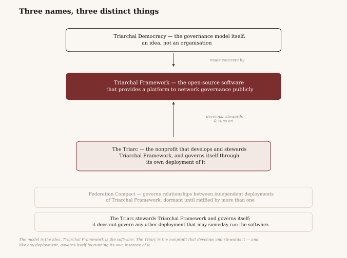

# About The Triarc

*The Triarc is a governance research organisation. It tests Triarchal Democracy by running its own
governance on it, it opens physical premises and postal channels so that people who cannot use the
system online still take part, and it stands up shadow deployments that mirror the real decisions of real towns and cities.
Triarchal Framework, the open-source platform it builds, is how that work becomes reproducible.*

---

---

## What it is

Most organisations proposing a governance model publish it and hope someone tries it. The Triarc runs
on it.

Liquid democracy, a verified contribution ledger, a two-tier dividend — the Triarc governs itself
with every mechanism the model proposes. Its participants elect its Delegates and settle its resource
questions by the same vote any deployment runs. Its dividend arithmetic comes out of the same code.
Its disputes go to the same randomly drawn panels.

That is the research method and the argument at once. A model that will one day ask a city for its
trust runs on itself first, where failure is cheap and public.

Three jobs follow from it.

## 1. A research tool

**The Triarc's primary output is evidence.**

Every mechanism in the model is a testable claim. Delegation renews instead of calcifying into
permanent super-delegates. A contribution ledger resists gaming. A dividend structure keeps outside
money out of the payout pool under pressure. Each of those is a claim measurement can settle, and the
Triarc measures them.

Its own governance is the first substrate: delegation-renewal completion rates against the 90-day and
annual cycles, Dispute Panel outcomes, treasury and dividend arithmetic — published quarterly, on a
fixed cadence, with what went wrong given the same space as what worked.

Publishing only successes produces marketing. Evidence is the only thing that will persuade a city,
and evidence includes the failures.

## 2. A place you can walk into, or write to

A governance system usable only by the technically fluent reproduces the exclusion this model exists
to remove. So the second job is physical.

**The Triarc intends to fund and staff real premises** — somewhere a person walks in and is helped to register,
cast a vote, log a contribution, or challenge one, without owning a smartphone or holding a data plan.
Around those premises: partnerships with libraries, community centres, and the local institutions that
already reach the people the internet does not.

**Nobody should have to travel to take part.** The design is for ballots, delegation instructions and
contribution records to go out and come back by post, verified the same way any online action is, and
land in the same ledger, so that a member who cannot reach a counter takes part from a kitchen table.

**None of this is built yet.** Phone and IVR delegation and voting, postal
ballot handling, and voting windows timed so that a mailed vote counts on the same terms as a tapped
one. These are first-class paths, not accommodations added afterwards.

A system that reaches only the connected produces research about the connected and a dividend for the
connected. Neither is the thing being tested.

## 3. Shadow deployments of real places

The Government Adoption Compact defines these as **Stage 1**: residents of a jurisdiction opt in, and
the platform mirrors that government's real decisions without binding force.

The Triarc runs them. A shadow deployment takes an actual town or city — its budget lines, its council
agenda, its decisions as they arrive — and puts them through the model in parallel. Nothing binds, and
nobody's permission is required. Residents opt in, deliberate, delegate, and decide.

**That produces the comparison nothing else can give.** Every council will ask what this would have
changed. A shadow deployment answers with a record: what a real population actually decided about real
questions, set beside what was decided for them.

It also removes the model's easiest escape route. A community writing its own agenda can steer around
the hard questions. A shadow deployment cannot — the agenda arrives from outside, on someone else's
schedule, including the items nobody wants to touch.

This is where the research stops being about the Triarc and becomes about governance. It is also where
accessibility becomes load-bearing: a shadow deployment reaching only the online half of a town is not
mirroring that town.

---

## What it builds

All three jobs run on the software, so the Triarc develops Triarchal Framework and supports the people
running it — training, accessibility outreach, and help standing up access points. A platform nobody
can use well produces no usable research.

Framework is open source under the GNU Affero General Public License v3.0, and the exit that
guarantees is the structural backing for every other promise here: any deployment can fork it and
self-host it in full, so no deployment is ever a hostage to the Triarc's board. If the Triarc's own
governance drifts, everyone else keeps working. The AGPL is the deliberate choice among open
licences: a modified version offered to people over a network must publish its source, so a hosted
fork of Framework cannot quietly become closed software. The exit stays open for the next deployment,
not only this one.

## How it is funded

Blended, so that no single source determines what the software does or who may use it.

**Grants and donations are the intended base.** No grant has been received and no support fee has been
charged. They are meant to keep the platform free regardless of a community's
resources: a small municipal deployment and a well-funded one start from the same software at the same
cost, which is nothing.

**A support fee sits on top, available only to deployments holding real delegated budget authority**
under the Government Adoption Compact's Delegated-Authority Mechanism. A deployment managing
meaningful public funds may buy a scaled level of support. The fee scales with what it manages and is
disclosed on both sides — what the Triarc charges, and what the deployment pays.

**That fee never reaches a dividend.** It is institutional money, bound by Treasury Code 1.4 like every
other institutional contribution, for every deployment without exception: it funds operations. A
support fee helps a deployment run. It never becomes part of what gets paid out. The dividend is the
community's own money, or it is not the Foundation Dividend. To be exact about what 1.4 bars: it is
institutional money, including the Triarc's own. Ordinary donations and grants do reach the pool through
the standing allocation of Treasury Code 2.1, and a government may explicitly designate delegated budget
into it under 5.6.

## How it is accountable

**The board answers to the people who use the software.** Participants elect the Delegates who hold the
Triarc's three Positions. Those Delegates are the corporation's members. The members elect and remove
the directors. One step, and every part of it public.

Participants are deliberately *not* members of the corporation. That separation lets the dividend be
paid to them without colliding with the rules on what a nonprofit may distribute to its own members,
and it leaves their governance rights untouched. Under the pattern, a Delegate takes no dividend while
serving and is compensated for the role instead. Federation Compact Article VIII sets it out in full,
as a **recommended** pattern: 8.3 keeps it deliberately out of the Founding Charter, and the Triarc's
own Treasury Code does not yet carry the exclusion. The structure is drafted and goes to counsel before
the articles are filed; whether the separation does the work claimed for it is one of the questions
counsel is being asked, not something settled here.

The internal structure follows the work rather than the six organisational sectors of Contribution Code 2.3: three sectors —
Nonprofit Operations, Data Collection & Research, Software Stewardship — with one Delegate Position
each. The Triarc Operations Code carries the reasoning, and the distinction that these are
Contribution Code Positions rather than corporate offices.

**On the word "DAO."** Authority here runs through a community vote rather than an appointed board, and
people reach for the term. It describes how power flows, not what the technology is. The Triarc will incorporate
federally under the Canada Not-for-profit Corporations Act, with three named directors at filing. No tokens, no smart contracts,
no on-chain voting, and a treasury that never touches cryptocurrency (Treasury Code 6.4: conventional
fiat custody through regulated institutions, no exceptions). The framing gets one thing right — no board is
appointed from outside the community. It gets one thing wrong by omission: during the founding period
the founder sets initial parameters and holds a suspensive veto over charter amendments and large
treasury movements (Charter 9.2, 9.3). That authority ends on measured criteria rather than on a date,
the founder has no role in declaring it met, and the community can end it at any time by two-thirds
vote under the ejection clause (Charter 9.5).

## Where this stands

Two things are built and running: the platform — real accounts, real delegation, a real contribution
ledger — and the AGPL-3.0 licence that makes the exit real. The Triarc's own governance is **not** yet
running on top of them: no Delegate Position has been filled, no Dispute Panel has been drawn, and no
dividend has been paid. Both tiers stay gated until thirty verified Members and every defined Position
filled (Treasury Code 5.1). Three things are ahead, in order.

**Incorporation.** The two-layer structure goes to Canadian nonprofit counsel, and the articles follow.

**The first premises, and the first shadow deployment.** Neither is standing today. Both are what the
funding is for, and both are what this organisation should be judged on.

Nothing above is described as finished that is not. Everything else here is what the Triarc is built to
do, and what it expects to be measured against.

---

**Where does it fail?**
