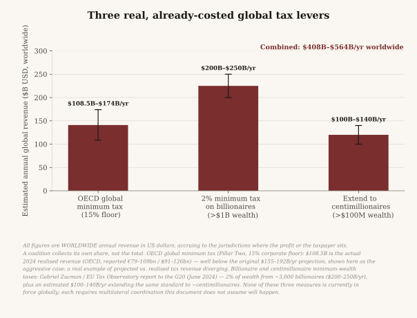

# Foundation Dividend Funding Research

*Supporting research for `docs/Triarchal_Democracy.md`'s Return pillar. This document works out, with real
current data, what population size a real, already-costed global tax-revenue pool could actually support at
a meaningful monthly floor — the arithmetic behind the claim that a Foundation Dividend funded this way is a
coalition-of-the-willing proposition at the scale of one to a handful of mid-sized countries, not a
G20-wide or worldwide program. Nothing here is claimed as part of Triarchal Democracy's core argument; it is
the reference math behind one paragraph of it.*

---

## Refining to the G20, and finding the actual optimal target

No single authority collects or distributes tax revenue for all 8.2 billion people on Earth, so a literal world-population framing is inherently somewhat artificial. The G20 is a better-grounded scope for a different reason: it isn't a made-up coalition for this analysis, it's the actual body that already commissioned two of the three revenue measures being modeled. The OECD's global minimum tax was negotiated through the OECD/G20 Inclusive Framework. The billionaire and centimillionaire minimum-wealth tax proposals came from a report Brazil's G20 presidency directly commissioned from economist Gabriel Zucman in 2024. Scoping the analysis to the G20 isn't a narrowing for convenience — it's scoping the money to the political body actually negotiating it.

The G20's 19 sovereign member states (the EU and African Union seats are excluded from this count to avoid double-counting states already listed individually — France, Germany, and Italy are EU members counted once each; South Africa is an African Union member counted once) total approximately 4.745 billion people, or 57.6% of world population (Worlddata.info, mid-2026).

Divide the same $408.5-563.5B/yr pool across all 4.745 billion G20 residents, and the result is $7.17-$9.90 per month — still nowhere near a meaningful floor. The reason is visible the moment the pool is applied to each G20 member individually instead of pooled: China and India alone hold 60% of the G20's population, and the five largest members (China, India, the United States, Indonesia, Brazil) hold 78% of it. Any arrangement that pools revenue across the full G20 at face value is, arithmetically, dominated by these five countries' population — not by the 14 smaller members, even though most of those 14 would individually clear a meaningful floor several times over if the same money were applied to their population alone.

Applied one G20 country at a time, 14 of the 19 members clear $250/month comfortably — from Mexico and Japan in the low hundreds up to Australia at over $1,200/month — only the five population giants fall short. Pool all 19 together, and the arithmetic collapses to under $10/month, because those same five giants now dilute everyone else's share too.

This gives a real, non-arbitrary way to answer "what's the optimal target": rather than picking $250/month by intuition, ask what is the largest population this specific, real revenue pool can support at $250/month or more, reliably, under both the conservative and aggressive revenue estimates. That population is **136.2-187.8 million people** — and Mexico's actual population (131.95 million) sits almost exactly at the conservative end of that band, clearing $250/month under both estimates ($257.99-$355.88/month).

**$250/month is, in fact, close to the optimal target value** — not because it was chosen for being a round number, but because it's approximately the largest floor a population the size of a single mid-sized G20 economy can support from this real revenue pool. Push the population higher (toward Russia's 143.5 million, or further), and the floor starts dropping below $250 at the conservative end. Push it toward the full G20 or the whole world, and the floor collapses by two orders of magnitude.

The practical implication: a Foundation Dividend funded this way is a coalition-of-the-willing proposition at the scale of one to a small handful of mid-sized countries — not a G20-wide program, and certainly not a worldwide one. That is consistent with how this model already scales in practice, through the Government Adoption Compact (one government at a time) and the Federation Compact (federating only as far as adopting governments actually choose to).

**What this section is not claiming.** It is not a claim that Mexico, or any specific G20 country, is a candidate for this exact program — the country-by-country breakdown is a scale reference, not a proposal naming that country. It is not a claim that G20 coordination on these three tax measures is imminent — the OECD minimum tax exists and is partially implemented; the wealth-tax measures remain proposals. It is not a claim that $250/month is livable — it remains an explicit floor-only target, not a claim about livable-income adequacy. It is a claim that, once real G20 population data replaces an abstract population variable, $250/month stops being an arbitrary ask and becomes close to the honest ceiling this specific, real revenue pool can support at meaningful scale.

## Beyond G20: which real coalitions actually clear the floor

**The pattern holds beyond the G20.** The G20 analysis established a structural pattern: pooling this revenue across a large, populous body dilutes it toward nothing, while applying it to a population on the order of 100-190 million reaches a meaningful floor. That pattern isn't specific to the G20 — it holds for every real multilateral body this revenue could plausibly move through.

Pooled across the OECD's 38 members (about 1.4 billion people), the same $408.5-563.5B/yr pool yields $24.32-$33.54/month. Across the G7 (787 million people), $43.23-$59.64/month. Across the European Union's 27 members (450.4 million, Eurostat, January 2025), $75.58-$104.26/month. Larger, broader bodies consistently dilute toward the same single-digit-to-low-double-digit range the G20 figures already showed — the G20 finding wasn't an anomaly of that one body, it's what happens to this size of revenue pool at that size of population, regardless of which real institution is doing the pooling.

**Where the pattern breaks in the other direction.** The same arithmetic that dilutes badly at large scale produces a real floor at smaller scale — and several real, existing, or actively-proposed partnerships happen to sit almost exactly at the population size this revenue pool can support.

**Canada and the United Kingdom** — both G7 and G20 members, with an active bilateral trade relationship — have a combined population of 111.14 million. Applied to just the two of them, this pool yields $306.30-$422.52/month: comfortably above $250/month under both the conservative and aggressive revenue estimates, with real margin to spare.

**CANZUK** — the actively-proposed enhanced-cooperation bloc among Canada, Australia, New Zealand, and the United Kingdom, built around their shared head of state, common-law tradition, and language — has a combined population of 143.9 million. This isn't a hypothetical grouping invented for this analysis: it's a real proposal with standing advocacy organizations and public political discussion in all four countries, though none of their governments has adopted it. Applied to CANZUK's population, the pool yields $236.56-$326.33/month — short of $250 at the conservative estimate, comfortably above it at the aggressive one.

**France and the United Kingdom** (138.21 million) — both G7, G20, and permanent UN Security Council members with a centuries-long history of bilateral coordination — yield $246.30-$339.76, essentially at the $250 line even at the conservative estimate.

**France and Germany** (152.21 million) — the single most consequential bilateral partnership in the European Union's own history, the acknowledged "engine" of European integration since the 1963 Élysée Treaty — yield $223.65-$308.51/month: short of $250 at the conservative estimate, but within reach at the aggressive one, from the two countries most institutionally practiced at exactly this kind of joint policy coordination.

Mexico, established in the previous section as the largest single G20 population that reliably clears $250/month, remains the strongest single-country reference point ($257.99-$355.88/month). Chart 26 places all of these on one axis, alongside the diluted aggregates (G20, OECD, G7, EU pooled in full), so the contrast is visible directly: broad, populous bodies dilute this revenue toward nothing; real, bilateral, or small-plurilateral partnerships reach a meaningful floor.

**What this section is not claiming.** It is not a claim that Canada, the UK, CANZUK's members, France, or Germany have any plan, proposal, or intention to pool tax revenue this way — Canada+UK and France+UK are real diplomatic relationships used here as population-scale references, not policy forecasts; CANZUK is a real proposal, but for enhanced mobility and trade cooperation, not this specific revenue mechanism. It is not a claim that bilateral or four-country cooperation is easier to achieve than G20-wide or OECD-wide cooperation — smaller groups still require real political agreement this document does not assume will happen. It is not a claim that any of the three tax measures underlying this pool is closer to enactment because the population math looks better at this scale. It is a claim that when the question is "what population size does this real revenue support," the honest answer keeps landing in the same 100-190 million range — and that several real partnerships, not just an abstract number, already sit there.
