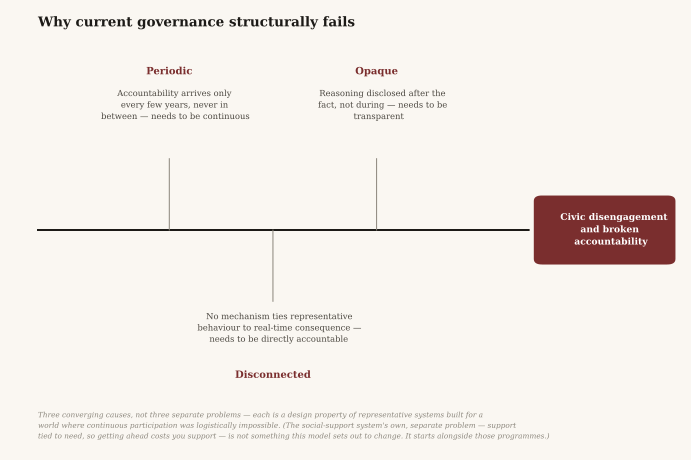
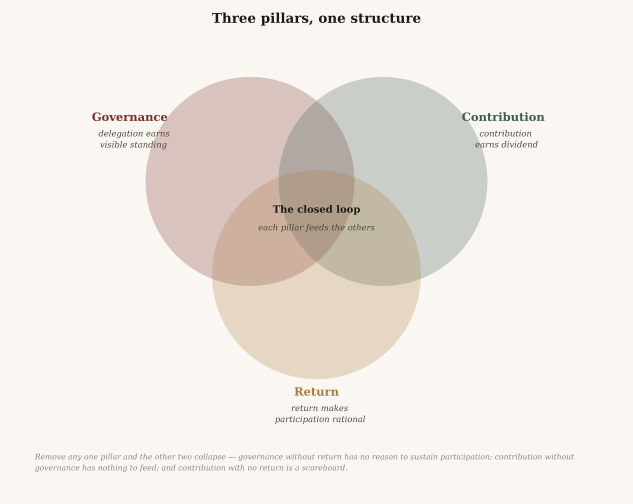
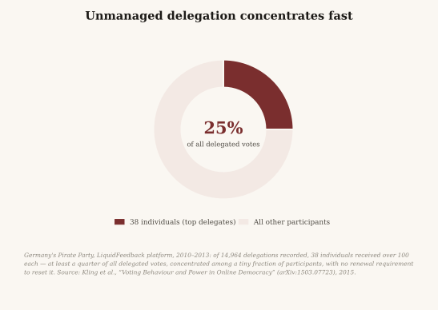
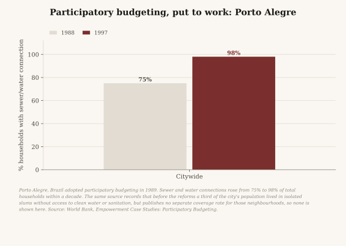
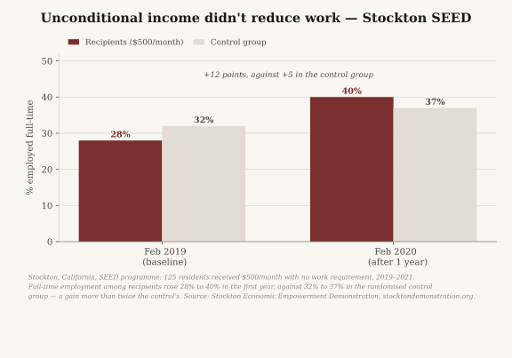
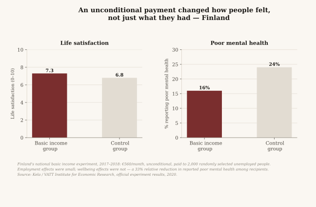
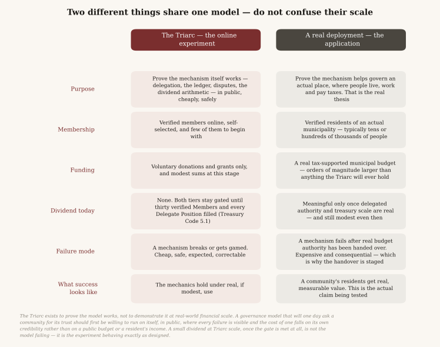

# Triarchal Democracy

*Governance, contribution, and civic return, built as one structure rather than three.*

---

## The problem

A resident's relationship with the community they live in is mediated by three systems that operate independently of one another.

**Governance** collects a judgement once every few years and then proceeds without further input. Between elections there is no mechanism by which a poor decision carries a cost for the person who made it. Accountability arrives late, applies to an entire record rather than to any specific decision, and cannot be adjusted in the interval.

One consequence is visible in almost every country. A programme introduced by one administration can be dismantled by the next, regardless of whether it was working, and the people who depended on it have no standing to object until the next election — by which time the thing is gone and the evidence with it. Policy becomes an inheritance dispute between governments rather than a decision a community made and can revisit.

**Social support** assesses a resident's circumstances and pays according to need. When circumstances improve, support is withdrawn. A person who is employed and contributing gets almost nothing back for it, and the credits aimed at low earners are income-tested as well, so they shrink as earnings rise. This is the intended arithmetic of means-testing rather than a defect in administration, but its effect is a structure in which improving one's position reduces one's income. The behaviour that follows is a rational response to the incentive, not a failure of character. This model does not replace social support or draw on it. It runs alongside, and adds a return that is not withdrawn when a person's circumstances improve: part paid equally to every adult member, part earned by contributing to one's community.

**Civic engagement** asks residents to participate and returns nothing measurable for doing so. Turnout campaigns, public consultations, and town halls all treat participation as an obligation rather than as something a resident might reasonably choose.

The cost of that is larger than low turnout, and is rarely stated. Engagement is how what a community knows reaches what a community decides, so when engagement returns nothing, the knowledge does not travel. The expertise a community requires is already held by its residents — engineers, clinicians, teachers, tradespeople, organisers — and under the current system it reaches a governance decision only when a government chooses to ask for it, or when the person holding it stands for office. A resident with something to offer has no standing way to offer it.

These are usually treated as separate fields, each with its own literature, budget, and professional class. They share a single cause. **There is no closed loop between a resident and the community they live in.** Contribution does not visibly return. Return does not depend on contribution. Knowledge held by residents does not reach the decisions that require it, and those decisions are made in a process residents cannot enter between elections.

The system most communities use was designed under a constraint that no longer applies. Direct participation at scale was once logistically impossible, so authority was delegated to a representative for a fixed term and an architecture of checks was built to contain it. The constraint has been removed by the technology of the last two decades. The architecture built around it has not changed.

These are failures of design rather than of politics, and they are therefore addressable by design.

---

## The proposition

Three pillars, built as a single structure rather than as three parallel programmes. Each depends on the other two.

**Governance** determines how decisions are made and how the people making them remain accountable continuously rather than periodically.

**Contribution** determines how civic work is verified, recorded, and recognised as a real input to community life.

**Return** determines how the value a community produces flows back to the residents who produced it — as a structural consequence of the system operating, not as charity or welfare.

*Triarchal* denotes rule by three: authority held jointly by all three pillars and by none alone.

None of the three components is novel in isolation. Liquid democracy is documented and has been deployed. Contribution ledgers exist in several forms. Universal basic income has a century of literature and a growing body of trial evidence. The claim made here is narrower and structural: these have not been built as one system, each fails in isolation for reasons the other two would address, and the failure is a property of the design rather than a shortfall of effort.

---

## Governance

**Purpose:** to make community decisions reflect the community continuously, and to carry the expertise residents already hold to the decisions that require it.

Residents vote directly on matters they understand and care about, and delegate the remainder — assigning their vote to a neighbour, a domain expert, or anyone whose judgement they trust on a particular subject. This is liquid democracy, and it has documented real-world use.

The same mechanism addresses the problem of unused expertise. A resident with no background in infrastructure planning delegates that subject to someone who has one, and withdraws the delegation the moment that person stops representing them. Expertise is recognised from within the community rather than appointed from outside it, and it remains accountable continuously. Treasury decisions follow the same route: every allocation is proposed, deliberated, and ratified in public, with domain knowledge reaching the decision through delegated trust that is visible, revocable, and never imposed.

Three properties distinguish this from representation.

**Delegation is specific.** A resident does not transfer general authority. They delegate their vote on housing, or on infrastructure, and may assign each subject to a different person.

**Delegation is revocable without delay.** Not at the next election, but at the moment a delegate diverges from the person who trusted them. The delegate's voting weight falls in real time by exactly the amount withdrawn.

**Delegation expires.** Every delegation runs on a renewal cycle and lapses unless actively renewed. This addresses a documented failure in other liquid-democracy deployments: left alone, delegation concentrates. Early recipients accumulate votes not because residents continue to choose them but because residents stop revisiting the choice. Renewal makes continued trust an affirmative act. Ordinary decisions renew annually. Constitutional amendments, large treasury movements, and the installation or removal of a compensated Delegate require more recent delegation than that, on the principle that a decision of that weight should not rest on a delegation nobody has considered in a year.

Together these remove the fixed term as the unit of accountability. A representative holds office until the term ends regardless of performance. A delegate holds standing only while residents continue to grant it, and remains subject to immediate revocation at any point in between.

The people who receive that trust are not appointed. A resident who builds a sustained record in a sector and attracts delegated trust within it is recognised as a **Civic Steward** for that sector — a role scoped to a subject rather than collapsed into a single general score. A Steward whose delegated support grows sufficiently to make civic work a primary occupation may be recognised as a **Delegate** for that sector: the functional equivalent of an elected official, compensated from public resources, and accountable in real time to the community that granted the standing. Every Steward and Delegate appears in a public directory organised by sector, because recognition that cannot be inspected cannot be held accountable.

A **sector** is a subject a community governs, and each community keeps its own list and can change it by ordinary proposal. A city deployment starts from what a city's budget actually covers: public safety; transportation; parks, recreation and culture; housing, planning and development; utilities and environment; and one sector for the work of running the deployment itself. A resident can then hand their transportation vote to someone they trust on transit and keep their own vote on everything else. A sector carries budget authority only where a government has actually delegated it; elsewhere it organises deliberation and delegation with no money attached. An organisation governing only its own operations starts from a different list, and the Triarc, as a small nonprofit, uses three: data collection and research, nonprofit operations, and software stewardship.

Every proposal moves through four public stages: submission, deliberation, voting, and record. All four happen in public and are kept on the permanent record, and the software that runs them is open source. The reasoning behind a decision forms part of that record rather than a polished summary published afterwards. Transparency is meant to be a property of the architecture rather than a policy a later administration can revise. The platform is not all the way there yet, and this page says below how far it has got.

---

## Contribution

**Purpose:** to make sustained participation viable by ensuring it counts for something.

A governance system that requires continuous engagement and returns nothing will not sustain it. This is an observed property of voluntary governance systems rather than a claim about human nature.

Every verified Member holds a **Contribution Record**: a public, append-only ledger of their civic activity. Contributions accrue to it in four domains: deliberation, craft, stewardship and attestation. Nothing on it is deleted. An entry found to be fraudulent can be voided by a Dispute Panel, and the panel's decision joins the record beside it.

Contribution is weighted across those four domains so that no single one dominates. Deliberation accrues. So does the work of keeping the community running, online or in person. So does peer attestation, the recognition by other Members of work that no automated measure can verify.

**Taking part has to fit into the time people actually have.** A resident working two jobs must be able to participate in the units of time they actually have: asynchronous deliberation, short reviews, attestation of work they are already performing. A cap limits what any resident may accrue in a single period, because a system that rewards engagement must not become one controlled by whoever has the most available hours. The relevant measure of this pillar is not how much its most active residents participate, but whether its least available residents can.

**The record determines standing and never voting weight.** This is the boundary the model does not cross. Contribution earns civic standing — eligibility for stewardship, and visibility as someone worth delegating to. It never produces a heavier ballot. Every binding decision is one resident, one vote, at every stage. Influence flows only through delegation that was granted deliberately and can be withdrawn immediately. Standing is earned continuously and cannot be purchased, inherited, or transferred.

Work is surfaced rather than assigned. Any resident may post an opportunity — a task or problem requiring attention, tagged by sector — and residents whose contribution history is relevant are shown it. Posting costs nothing and claims nothing; completing the work is credited exactly as any other contribution is. Residents may also follow sectors directly, and that declared interest, combined with their own contribution history, is the only signal used to rank their proposal feed and the Steward directory. The ranking parameters are disclosed and amendable by the community, and the complete unranked list remains available at all times. Personalisation adds a view and never removes one.

A Delegate's position sits within a visible structure. A Delegate may nominate residents who already hold an earned record in that sector to support the work of the position. A nomination confers a recognised role only, never a share of the Delegate's vote or delegated authority. Every nomination is recorded publicly when it is made, and any resident may challenge one: a question of conduct goes to a randomly drawn dispute panel, and a question of suitability goes to a community vote. Nominated roles lapse automatically when the nominating Delegate's position does, so that no appointed role outlasts the accountability for having made the appointment.

---

## Return

**Purpose:** to close the loop, so that a community which governs itself well produces a return its residents can observe.

Two tiers serve two distinct functions.

**The Foundation Dividend** is paid to every verified Member irrespective of contribution. There is no means test and no assessment of need. Verification establishes only that someone is a real, unique person, and the dividend follows from membership rather than from anyone's circumstances. Its function is to give every Member an unconditional share of the pool, half of it by default, and no improvement in their circumstances reduces it. It is a proportion rather than a fixed floor, deliberately: a fixed amount would swallow a small pool whole and shrink to a token in a large one. There is no benefit cliff and no condition to maintain.

This inverts the structure of means-tested support rather than extending it. A distribution that reaches every resident unconditionally is not assistance; it is the community returning to each resident a share of what the community produced.

That is the **first-year** result, from a treatment group of 125 people. The second year of the trial ran through the pandemic, and the final evaluation did **not** find the employment effect to be statistically significant. The honest summary is that one year of evidence pointed one way, a second year under extraordinary conditions did not confirm it, and a trial of this size could not have settled the question either way. It is offered here as a reason the usual objection is not self-evident, not as proof that it is wrong.

**The Civic Dividend** is earned, and scales with the Contribution Record up to the cap the community sets. It grows with contribution and never contracts because a resident's circumstances improved.

Taken together, the Foundation Dividend ensures no resident sits outside the system, and the Civic Dividend ensures engagement produces a measurable return. Every resident holds both a baseline stake and a reason to increase it.

**No fixed amount is promised, and that is deliberate.** The dividend is a share of what the treasury can sustain, recalculated each cycle. A distribution that tracks real capacity cannot be overpromised, cannot be underfunded into crisis, and gives every Member a direct interest in the treasury growing. The cost is that it can fall as well as rise, so nobody can plan a household budget around it. The claim is not that existing budgets could fund a substantial dividend immediately; they could not, and any model asserting otherwise has not completed the arithmetic. The claim is narrower: a community that governs itself well attracts more of the support that funds it, and the pool grows with the treasury. That treasury has four sources: donations, grants, revenue the community votes to pursue, and budget a government has explicitly designated.

Distribution does not begin immediately. It activates once a community reaches thirty verified members with every defined Delegate position filled, and is permanent from that point. The threshold exists because a return paid before anyone holds accountable office over the treasury funding it is a return for which no one can answer.

The treasury draws on what any community organisation can raise: member contributions, grants, and revenue the community votes to pursue. As a deployment matures it may also be delegated authority over part of a government's own discretionary budget, and over wage budgets that ordinary attrition has emptied.

**It does not count anyone's disability support, income assistance, pension or child benefit.** None of those programmes is part of the plan, and every figure in this project leaves them out. The founding documents keep every programme that depends on assessing a person's disability, need or means outside what a government hands over to a deployment, unless the community itself decides otherwise. Members can make that decision by ordinary vote, in public, most plausibly once the dividend has grown enough to make the trade worth weighing, though the rules set no size test. Everyone already receiving the programme keeps it, and only the founding documents' highest threshold, three quarters of the vote with 40% participation, could ever reduce what they receive. The cost falls on people who come to need it later: redirection closes a programme to new applicants, so someone who would have qualified afterwards receives the dividend instead. A government can hand over an ordinary subsidy it runs on the same terms. The model starts alongside these programmes rather than in place of them; whether that ever changes is for the community to decide.

The consequence is a small dividend pool. On published budgets plus two stated assumptions it converges on **$21.24 to $28.79 per entitled adult per month**, both tiers together — the spread is how much federal payroll is taken to be substitutable, and the arithmetic page derives both ends; a mature municipal deployment alone supports at most about **$8.33 per resident**, which is $10.16 per adult. Those two units are not interchangeable and this document keeps them apart. The rules are the product; the dividend is what the rules produce. If the system governs well the treasury grows, and the pool grows with it.

A legislature may eventually choose to go further and guarantee a genuine income floor: enough to bring everyone below a subsistence threshold up to it. That is its decision to make and its money to find, and this model is not the instrument for it. A deployment has no power to tax, no power to run a benefit, and no say in who qualifies for one. The arithmetic is worth setting out anyway, because it shows what a floor like that would actually take.

Canada's Parliamentary Budget Officer has costed a national guaranteed basic income at roughly **$107B gross**, offset to a net cost of about **$5B**. That near-neutrality is real, but it does not come from ending eligibility testing. It comes from eliminating existing low-income programmes and tax measures and reducing basic personal amounts — roughly $56B federal and $50B provincial. Administrative saving is not what closes the gap, and the orders of magnitude show why it could not be: B.C.'s published administration line is $170.7M on a $2,474.9M programme, so moving it to the ~1% typical of a universal programme would release about $146M — under six per cent of the programme, against a gap measured in tens of billions.

Both of the PBO's offsets are **closed to a deployment under our own rules**. A deployment cannot change the tax system, and the programmes that would have to end are ones this model does not touch. So the claim has to be the narrow one. An income floor at that level comes close to paying for itself only if a legislature ends existing low-income programmes and reshapes the tax base to fund it. That is a real trade, because people rely on those programmes today. It belongs to a legislature and the people who elect it, and this model neither proposes it nor depends on it. What the model supplies either way is evidence and a public record. A legislature that acts does so on its own authority, with its own instruments.

The model is not economically inert, and does not claim to be. Where a deployment holds delegated authority over how already-collected public money is spent, that is genuine economic influence. It is narrower in scope than setting a tax rate, and it is real.

---

## The loop

Each pillar supplies the conditions for the next.

Governance that functions well produces decisions that reflect the community, delegates who remain accountable, and deliberation that can be audited. Better decisions produce better outcomes: infrastructure maintained, budgets reaching their stated purpose, services functioning, and public trust accumulating. Better outcomes generate additional community value, which expands the treasury. A larger treasury funds larger returns across both tiers. Larger returns make participation rational for more residents. Wider participation deepens the contribution pool, which improves both the quality of governance decisions and the accountability of those making them.

The loop also runs in reverse. Poor governance degrades outcomes, degraded outcomes reduce value, smaller returns make participation less rational, and reduced participation weakens governance further. Nothing in the design prevents this. What the design provides is that everyone inside the loop experiences the decline directly and holds a stake in reversing it, which is not true of a system where the consequences of poor governance fall on people with no means of responding before the next election.

---

## Where it begins

At municipal scale — communities of roughly 20,000 to 150,000 residents, where governance problems are concrete, feedback is rapid, and trust is local enough to establish. This is a starting point rather than a ceiling; the model is designed to operate alongside government at any level.

Nothing needs to be displaced. A deployment runs in parallel with existing government: mirroring decisions, building a verified resident base, and producing a public record of outcomes. Authority transfers incrementally, and only as the community ratifies each transfer through the democratic processes that already exist.

That transfer runs on two independent tracks, and neither depends on the other.

**The first requires no action by any government.** A sitting official appears as the default holder of their own seat's delegated support. There is no council vote, no charter amendment, and no change to their legal office. What changes is visibility: residents can see how much delegated trust the official holds and can redirect it, exactly as any delegation moves. This can begin in any community immediately.

**The second is a formal delegation of budget authority.** It begins with a single bounded line, is ratified by the elected body before it binds, and is scoped only to the discretionary portion of a budget — the portion not already committed to debt service, pension obligations, or standing contracts.

Organised local business is given a formal channel: a standing non-voting advisory seat for budget and economic-development matters, distinct from resident deliberation and voting, and conferring no vote beyond the one every member already holds. Incentive negotiations, confidential commercial terms, and long-horizon infrastructure decisions require a legible route into the process that general deliberation does not reliably provide. These discussions occur in every community already; the difference is whether they occur in a forum that can be observed.

Each community where the model works is the evidence for the next. The software is open source, no central authority holds power over any deployment, and what is demonstrated at one level becomes available at the next.

---

## Where this is hardest

Every model has points at which it strains. These are this one's, stated rather than defended.

**Concentration is not capture, and the distinction carries the argument.** A Delegate who serves a sector well continues to attract trust, and accumulated trust resembles, at a distance, what every critique of representation warns against. Three distinct things are commonly conflated. *Concentration* is becoming influential by following the rules exceptionally well. *Corruption* is breaking them to obtain power that was never granted. *Capture* is becoming sufficiently dominant that removal ceases to be practical regardless of what the rules provide.

This model does not prevent concentration, and a model claiming to would be misrepresenting itself. Sustained good judgement should attract sustained trust; penalising that would penalise the behaviour the model exists to encourage. The narrower claim is that influence may accumulate while remaining transparent, contestable, non-hereditary, non-purchasable, and removable at every stage. A Delegate's support has a floor above which the position is held automatically, a band below it that triggers a confirmation vote, and a further threshold below that which starts a public countdown to automatic removal. The objective is not to limit how much trust a resident earns. It is that trust which has ceased to be earned ceases to be held, on a defined public timeline, without requiring an extraordinary intervention.

The relevant test is not how much influence a person holds. It is whether the mechanism that would remove it still functions.

**The funding arithmetic does not extend as far as people assume.** Where a deployment eventually draws on revenue pooled across governments rather than raised by its own community, the realistic scale is narrower than a global programme. Spread thinly enough, even large sums reduce to a few units of currency per person per month and cease to mean anything. Concentrated on fewer people the same pool goes further per person — but a coalition collects its own share of a worldwide total, not the total, and that share is far smaller than dividing one by the other suggests. This model has not calculated it and does not claim a figure. A dividend funded that way would be a coalition of a few governments rather than a worldwide scheme, which is consistent with how this model scales in any case, one government at a time.

**The infrastructure must do several things that are difficult.** It must verify one real, unique person per account without constructing a surveillance system. The intended architecture is zero-knowledge identity: a person is checked once against real records, the check is reduced to a proof that they are unique, and the underlying documents are discarded, so that no one, including whoever runs the platform, holds a database of identities. This is the hardest requirement on the list. Zero-knowledge identity at civic scale is an active and improving field rather than a solved problem, and the platform is not there yet. Today it stands at the first of four stages: conventional sign-in, with the privacy guarantee resting on access rules and policy rather than on cryptography.

It must maintain a public, append-only record that no future administration can revise, anchored cryptographically by construction rather than by policy — a destination reached in stages, which a live deployment reports accurately rather than assumes. The deployed platform is at **Stage 1** today: append-only by application convention, enforced by access control and audit, not yet by cryptography. It must prevent the contribution ledger from being farmed, through peer attestation, diversity requirements, and weightings the community can adjust when an exploit is found; a ledger that can be farmed is worse than no ledger. It must resolve disputes without a central authority, through panels drawn verifiably at random so that they cannot be composed in advance. And it must move money transparently while holding it conventionally, in regulated fiat custody and never in cryptocurrency: the ledger's function is that nothing can be concealed or rewritten, not that the treasury assumes currency risk.

All of this must operate on an inexpensive phone over a slow connection, in the languages the community speaks, with physical access points and postal channels for residents who do not use smartphones, and without requiring any resident to understand the underlying mechanism. A governance system usable only by the technically fluent would reproduce the exclusion the model exists to remove. Accessibility is a governance requirement rather than a feature.

**The most valuable things this model could enable are the ones it cannot legislate.** A deployment decides how already-collected discretionary money is allocated. It does not set tax rates, create entitlements, or bind a legislature. Anything beyond that scope depends on elected bodies choosing to act, and they may not. The answer is not a guarantee but a wager: a population that receives something, sees the record, and holds a continuous vote on the budget it comes from is harder to overrule than one that can only wait for the next election. That is a claim about political economy, and it is among the likeliest in this document to be wrong.

**The work is not finished.** The structural argument is sound. The mechanism design has open problems. The political pathway is uncertain. It is offered as a model under development, intended to be tested by the people who engage with it.

---

## Introducing the Triarc, and what it does

Three things share a name closely enough to require separation.

1. **Triarchal Democracy** is the governance model: the argument set out in this document.
2. **Triarchal Framework** is the open-source software that makes the model operable.
3. **The Triarc** is the nonprofit that develops and stewards that software. It governs itself by the model rather than only publishing it.

The Triarc is a live community with real accounts, real delegation and a real contribution ledger. It has not paid a dividend, and will not until it has thirty verified Members and every Delegate position filled. **An actual deployment of Triarchal Framework is a different kind of thing, not a larger version of the same one:** it is a government operating one of the two adoption tracks set out in the Government Adoption Compact.

The Triarc's purpose is to demonstrate that the *mechanism* works: that delegation resolves as the charter specifies, that the ledger remains append-only, that a randomly drawn panel reaches decisions within its window, and that the dividend arithmetic balances. It does this inexpensively and in public, where failure is visible and its cost falls on the Triarc's own credibility rather than on a municipal budget or a resident's income.

A real deployment's purpose is to demonstrate that the mechanism *helps govern an actual place*, with a real budget, real residents, and real consequences if delegation or dispute resolution fails.

For this reason the Triarc's own dividend, once it activates at all, will remain small and possibly symbolic for a considerable time. This is not the model failing to meet its stated purpose; it never claimed that a dividend at Triarc scale would be substantial. A small and honestly funded treasury produces a small and honestly computed dividend. Assessing the model by that figure measures the wrong thing.

A governance model that will eventually ask communities for their trust should first be willing to operate on itself, in public, where every failure is visible. That is the Triarc's function.

---

## What this is not

**Not a position on the political spectrum.** The model does not determine what a community decides. It determines whether what a community decides reflects the residents who live with the result.

**Not a replacement for employment, taxation, or the existing economy.** Members retain their employment and pay their taxes exactly as before. The model adds a parallel civic layer — an additional route to contribute and be recognised for it — and requires no resident to leave the system they already live in. Even at full maturity a deployment determines how already-collected discretionary revenue is allocated. It does not set a tax rate, compel a payment, or claim private property. What changes is who decides how money already being spent is directed, not who pays or how much.

**Not a technology project.** The technology is the implementation layer. The argument is structural: how governance, contribution, and return should relate to one another, and why constructing them as one system produces a result none of them reaches independently.

---

## The question

Governance produces accountability once every few years. Social support withdraws as the condition it addresses improves. Civic engagement returns nothing measurable to the residents who participate — and so the expertise those residents hold never reaches the decisions that require it.

These are not three problems. They are one: the absence of a closed loop between a resident and the community they live in. Constructing that loop as a single structure is what allows each of them to be addressed.

That is the argument. It is offered for examination.

**Where does it fail?**
